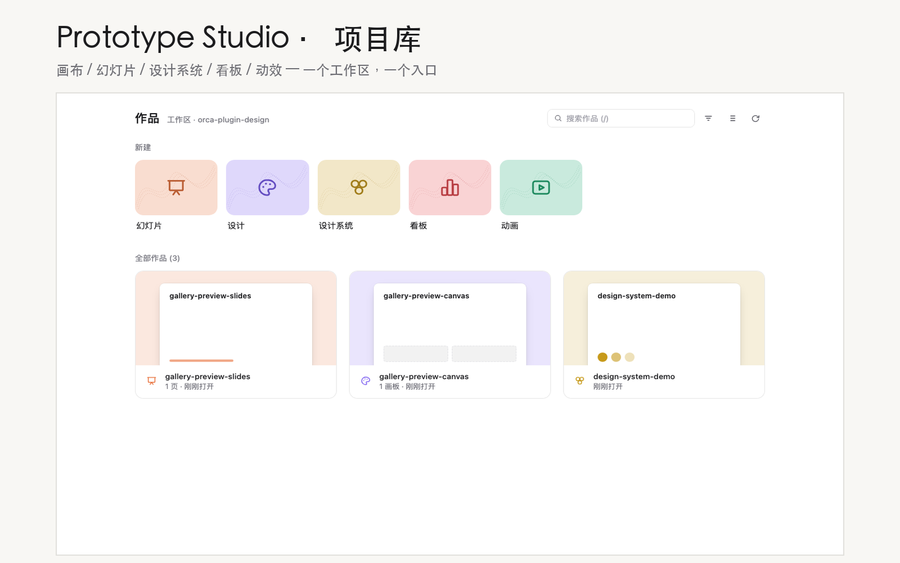

# Agy Design Studio (`agy-plugin-design`)



面向 **Google Antigravity**（基于 [Agy-Daddy](https://github.com/agy-daddy/agy-daddy) 微内核 v2 底座）的本地优先可视化设计工作台插件：集中管理**幻灯片（Slides）、无限画布（Canvas）、设计系统（Design System）、数据看板（Dashboard）与动效（Motion）**五类作品，并通过 `<workspace>/.design/` 与 Orca `orca-plugin-design` 保持 100% 双向兼容。

| 工作台项目库 | 画布编辑器 |
| :---: | :---: |
|  |  |

## 快速开始

1. 在 Antigravity 中打开任意本机项目文件夹（工作区）。
2. 点击顶部栏右侧 **Design** 胶囊，或按快捷键 `Mod+Alt+P`（macOS 为 `Option+Cmd+P` / 可在插件设置自定义）。
3. 点击后工作台右侧抽屉（或系统浏览器）立即打开：
   - 启用内置品牌设计系统或使用精选示例直接创建可编辑作品；
   - 点击任意作品卡片进入嵌入式编辑器，顶部工具条可随时「← 返回工作台」或「浏览器打开 ↗」。

## 五类作品与工作区协议

所有由本插件创建的作品落盘在 `<工作区>/.design/<作品名>/`（最深扫描 3 层）：

| 类型 | 技能 ID | 识别文件 | 默认编辑器端口 | 创建方式 |
|---|---|---|---|---|
| 幻灯片（Slides） | `claude-slides` | `project/deck.json` | `4710` | 内置示例一键创建 / Agent 创作（导出 PDF / HTML / PPTX） |
| 无限画布（Canvas） | `claude-design` | `project/canvas.json` | `4720` | 内置示例一键创建 / Agent 创作 |
| 设计系统（Design System） | `claude-design-system` | `project/design-system.json` | `4730` | 内置默认设计系统一键初始化 / Agent 创作（单工作区唯一） |
| 数据看板（Dashboard） | `claude-dashboard` | `db/dash/meta.json` | `4740` | 由 Antigravity Agent 结合数据创建（不建空壳模板） |
| 动效（Motion） | `claude-motion` | `db/film/meta.json` | `4760` | 由 Antigravity Agent 创作（导出 MP4 / GIF） |

## 与 Orca 设计插件的双宿主隔离

| 维度 | `orca-plugin-design` | `agy-plugin-design` |
|---|---|---|
| Gallery 服务端口 | `127.0.0.1:3480` | `127.0.0.1:3481`（可在插件设置修改） |
| 应用数据目录 | `<orcaUserData>/baoyu-design`（`ORCA_DESIGN_HOME`） | `<AgyStateDir>/plugins-data/hubo1989.design/baoyu-design`（`AGY_DESIGN_HOME`） |
| 状态快照文件 | `prototype-studio-state.json`（`ORCA_STATE_FILE`） | `<pluginDataDir>/runtime-state.json`（`AGY_DESIGN_STATE_FILE`） |
| 工作区作品目录 | `<workspace>/.design/<name>/` | `<workspace>/.design/<name>/`（100% 双向互通） |

## 权限与安全边界

- 渲染层严格运行于 `world: "isolated"`，不申请 `page:main-world`、`host:launch-args`、`host:control`、`rpc:write` 或外网出站权限。
- 仅申请 6 项必需静态权限：`dom:read`、`dom:write`、`rpc:read`、`fs:user-files`、`net:listen`、`process:spawn`。
- Gallery HTTP 服务仅绑定 `127.0.0.1`，所有状态变更接口经 `src/post-guard.mjs` 执行 `POST + application/json + 同源 Origin + 64 KiB` 四重校验，且对目标目录执行 `realpath` 防软链逃逸检查。
- 远程工作区（SSH / Dev Container / WSL）与插件安装目录会被明确拦截，绝不在错误路径写盘，也不强杀非本插件的第三方进程。

## 开发与验证

```bash
node tools/vendor-baoyu.mjs apply-rewrites && node tools/vendor-baoyu.mjs --check
node scripts/verify.js
npm test
bash bin/package.sh
```

## 许可证

Mixed. 插件自有宿主适配层、Gallery 服务与工具代码采用 **MIT License**（见 [LICENSE](LICENSE)）；`vendor/baoyu-design/` 包含 Anthropic 衍生技能说明、编辑器资产及 `anthropicons` 字体，仍归 Anthropic, PBC 所有且不适用 MIT 许可。完整三层权利声明见 [NOTICE.md](NOTICE.md)。
