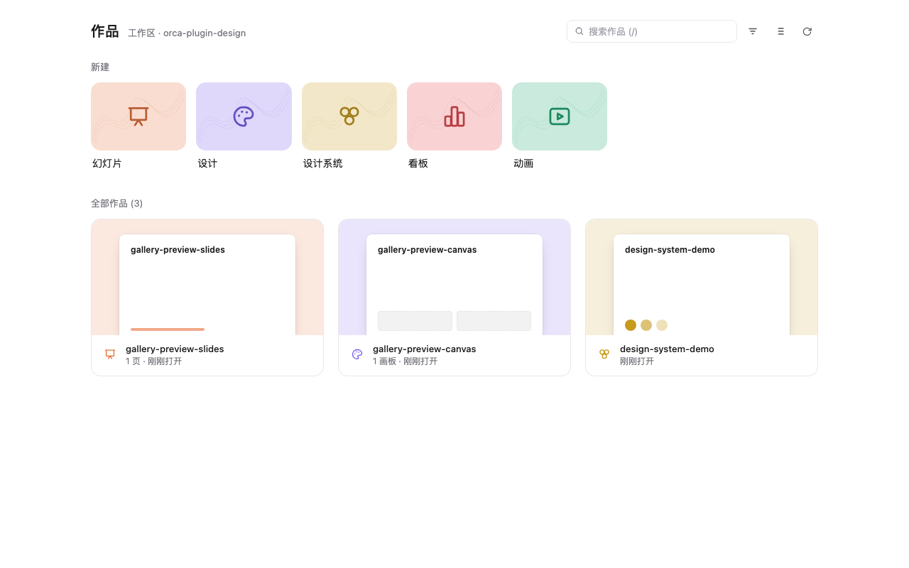
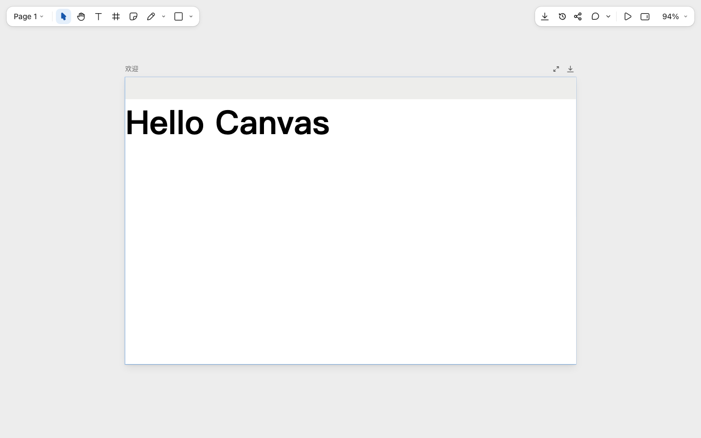

# Agy Design Studio (`agy-plugin-design`)


面向 **Google Antigravity**（基于 [Agy-Daddy](https://github.com/agy-daddy/agy-daddy) 微内核 v2 底座）的本地优先可视化设计工作台插件：集中管理**幻灯片（Slides）、无限画布（Canvas）、设计系统（Design System）、数据看板（Dashboard）与动效（Motion）**五类作品，并通过 `<workspace>/.design/` 与 Orca `orca-plugin-design` 保持 100% 双向兼容。

| 工作台项目库 | 画布编辑器 |
| :---: | :---: |
|  |  |

---

## 分步安装与使用指南（非开发者适用）

> **前置条件**：请先在电脑上安装 **Google Antigravity** 桌面客户端，并已完成 **Agy-Daddy 底座**安装（若尚未安装，可先按 [Agy-Daddy 安装说明](https://github.com/agy-daddy/agy-daddy#download--installation) 启动 `Agy-Daddy Launcher`）。
>
> **私有仓库提示**：若 `hubo1989/agy-plugin-design` 尚未转为公开仓库，使用公开 HTTPS 注册表短名安装前请先确认仓库已公开，或使用下文「本地目录软链 / SSH 克隆」方式安装。

### 第一步：安装插件并完成首次权限确认

本插件在 `T1`（社区已审）信任级别下声明了本地编辑器子进程（`process:spawn`）、本地项目读写（`fs:user-files`）与本地回环监听（`net:listen`）权限，首次安装时需要您确认授权。您可以任选**图形界面**或**终端命令**其中一种方式：

#### 方式 A：在 Antigravity 图形界面中安装（推荐）

1. **在哪操作**：打开 **Google Antigravity** 桌面应用窗口。
2. **怎么打开**：点击窗口顶部栏的 **「Agy-Daddy 设置」**（或系统菜单栏托盘中的 Agy-Daddy 图标 → **「打开设置中心」**），在弹窗顶部切换到 **「插件管理」** 标签页。
3. **操作步骤**：
   - 在页面下方的插件市场目录中找到 **Agy Design Studio**（`hubo1989.design`），点击 **「安装」**；或在顶部安装输入框中输入 `design`（仓库公开后可用）或本地插件目录路径 `local:<您的 agy-plugin-design 文件夹完整路径>` 后点击 **「安装插件」**。
   - 页面弹出 **权限确认提示卡**（列出 `process:spawn`、`fs:user-files`、`net:listen`）时，点击 **「授权并安装」**。
4. **预期看到什么 / 看到什么算成功**：
   - **「已安装插件」** 列表中出现 **Agy Design Studio（`hubo1989.design`）**，状态徽章显示 **社区已审（T1）**，且右侧开关处于 **开启** 状态。
   - Antigravity 窗口顶部栏右侧出现带有层叠图标的 **Design** 按钮。

#### 方式 B：在系统终端中一键安装

1. **在哪操作**：
   - macOS：按下 `Command + 空格`，输入 **「终端」**（Terminal）并回车打开。
   - Windows：按下 `Win` 键，输入 **「PowerShell」** 并回车打开。
2. **复制粘贴以下命令并回车执行**：
   - 若仓库已公开发布到 Agy-Daddy 注册表：
     ```bash
     agy-daddy plugin install design --grant process:spawn,fs:user-files,net:listen
     ```
   - 若您已将本仓库下载或克隆到本地文件夹（例如 `~/Projects/agy-plugin-design`）：
     ```bash
     agy-daddy plugin install local:/绝对路径/agy-plugin-design --grant process:spawn,fs:user-files,net:listen
     ```
3. **预期看到什么输出**：
   终端打印 JSON 结果，其中包含以下关键字段即代表安装成功：
   ```json
   {
     "ok": true,
     "plugin": {
       "id": "hubo1989.design",
       "version": "0.1.0",
       "enabled": true
     }
   }
   ```
4. **看到什么算成功**：切换回 **Google Antigravity** 窗口（已开启 `agy-daddy live` 时会自动热注入，无需重启），在窗口顶部栏右侧能看到 **Design** 按钮。

---

### 第二步：点击顶栏 `Design` 打开项目库

1. **在哪操作**：**Google Antigravity** 桌面端主窗口。
2. **怎么打开**：
   - 先确保 Antigravity 左侧/当前会话已打开一个**本机项目文件夹**（非 SSH / 容器远程工作区）。
   - 点击窗口顶部栏右侧的 **Design** 按钮，或直接按快捷键：`Option + Command + P`（macOS）/ `Alt + Ctrl + P`（Windows / Linux）。
3. **预期看到什么反馈**：
   - **立即反馈（无卡顿假死）**：点击瞬间顶栏按钮变为旋转加载图标并显示 **「打开中…」**，同时窗口右侧同步滑出与当前 Antigravity 深色/浅色主题一致的 **Agy Design Studio** 工作台抽屉与骨架屏动画（无需重复点击）。
   - **列表加载完成**：随即显示当前工作区的设计作品卡片（或引导创建卡片）。若当前文件夹尚未有作品，可点击内置精选示例或 **「开启设计系统」** 一键生成首个可编辑作品。
4. **看到什么算成功**：
   - 能够看到 **Agy Design Studio** 项目库页面，且顶部工具条包含 **「浏览器打开 ↗」**、**「全屏 / 分屏切换」** 和 **「关闭」** 按钮。
   - 点击任意作品卡片后可直接进入编辑器；点击编辑器左上角 **「← 返回工作台」** 可顺畅回到项目库列表。

---

### 第三步：与 Orca 设计插件双宿主共用 `.design/`

如果您同时使用 **Orca**（`orca-plugin-design`）和 **Google Antigravity**（`agy-plugin-design`），两个插件对项目文件的存储格式 100% 互通，同时各自保持端口与个人回收站隔离：

1. **在哪操作**：在 **Orca** 和 **Google Antigravity** 中打开**同一个本机项目文件夹**。
2. **怎么验证互通与隔离**：
   - 在 Antigravity 中点击顶栏 **Design** 创建或修改一个作品（例如幻灯片或画布），文件会实时保存在 `<您的项目文件夹>/.design/<作品名>/`。
   - 切到 Orca 打开其 Design 面板，刷新列表即可直接看到并继续编辑同一个作品（反之亦然）。
   - **端口与个人数据互不冲突**：Antigravity 插件默认运行在 `127.0.0.1:3481`，Orca 插件运行在 `127.0.0.1:3480`；两者的回收站（`trash/`）与缩略图缓存（`thumbs/`）保存在各自独立的应用目录中，在 Antigravity 中删除到回收站不会误删 Orca 的索引缓存，停用 Antigravity 插件也不会关停您正在 Orca 中打开的编辑器。

---

### 第四步：遇到端口冲突时修改端口设置

如果点击 **Design** 后页面提示：
`设计工作台端口 3481 已被其他程序占用，请在插件设置中修改端口后重试。`
插件**不会**强行关闭占用该端口的其他软件，请按以下步骤更换端口：

1. **在哪操作**：点击错误提示卡片上的 **「修改端口设置」** 按钮（或打开 **Antigravity → Agy-Daddy 设置 → 插件管理 → Agy Design Studio**）。
2. **怎么操作**：
   - 找到 **「本地项目库服务端口」** 输入框（默认值为 `3481`）。
   - 将数字修改为一个空闲端口（例如 `3482` 或 `13481`，允许范围 `1024 ~ 65535`，注意避开 Orca 的 `3480` 及 Agy-Daddy 内置的 `18765~18767`）。
   - 点击设置页中的 **「重启设计工作台本地服务」** 按钮（或者直接点击错误卡上的 **「重试启动」**）。
3. **看到什么算成功**：
   - 再次点击顶栏 **Design** 按钮后不再出现端口占用提示，工作台抽屉顺利加载出项目库列表；点击 **「浏览器打开 ↗」** 时，浏览器地址栏显示为您修改后的新端口（例如 `http://127.0.0.1:3482/...`）。

---

## 五类作品与工作区协议

所有由本插件创建的作品落盘在 `<工作区>/.design/<作品名>/`（最深扫描 3 层）：

| 类型 | 技能 ID | 识别文件 | 默认编辑器端口 | 创建方式 |
|---|---|---|---|---|
| 幻灯片（Slides） | `claude-slides` | `project/deck.json` | `4710` | 内置示例一键创建 / Agent 创作（导出 PDF / HTML / PPTX） |
| 无限画布（Canvas） | `claude-design` | `project/canvas.json` | `4720` | 内置示例一键创建 / Agent 创作 |
| 设计系统（Design System） | `claude-design-system` | `project/design-system.json` | `4730` | 内置默认设计系统一键初始化 / Agent 创作（单工作区唯一） |
| 数据看板（Dashboard） | `claude-dashboard` | `db/dash/meta.json` | `4740` | 由 Antigravity Agent 结合数据创建（不建空壳模板） |
| 动效（Motion） | `claude-motion` | `db/film/meta.json` | `4760` | 由 Antigravity Agent 创作（导出 MP4 / GIF） |

## 与 Orca 设计插件的双宿主隔离

| 维度 | `orca-plugin-design` | `agy-plugin-design` |
|---|---|---|
| Gallery 服务端口 | `127.0.0.1:3480` | `127.0.0.1:3481`（可在插件设置修改） |
| 应用数据目录 | `<orcaUserData>/baoyu-design`（`ORCA_DESIGN_HOME`） | `<AgyStateDir>/plugins-data/hubo1989.design/baoyu-design`（`AGY_DESIGN_HOME`） |
| 状态快照文件 | `prototype-studio-state.json`（`ORCA_STATE_FILE`） | `<pluginDataDir>/runtime-state.json`（`AGY_DESIGN_STATE_FILE`） |
| 工作区作品目录 | `<workspace>/.design/<name>/` | `<workspace>/.design/<name>/`（100% 双向互通） |

## 权限与安全边界

- 渲染层严格运行于 `world: "isolated"`，不申请 `page:main-world`、`host:launch-args`、`host:control`、`rpc:write` 或外网出站权限。
- 仅申请 6 项必需静态权限：`dom:read`、`dom:write`、`rpc:read`、`fs:user-files`、`net:listen`、`process:spawn`。
- `process:spawn` 严格限定为本地受控子进程用途：启动本插件自带 `src/gallery-server.mjs`、调用本地 `vendor/baoyu-design/skills/*/scripts/artifact.mjs` 编辑器与 `tools/thumb.mjs` 缩略图生成，以及响应用户显式点击外跳系统浏览器（无任何远端命令拼接或任意 shell 执行）。
- Gallery HTTP 服务仅绑定 `127.0.0.1`，所有状态变更接口经 `src/post-guard.mjs` 执行 `POST + application/json + 同源 Origin + 64 KiB` 四重校验，且对目标目录执行 `realpath` 防软链逃逸检查。
- 远程工作区（SSH / Dev Container / WSL）与插件安装目录会被明确拦截，绝不在错误路径写盘，也不强杀非本插件的第三方进程。

## 开发与验证

```bash
node tools/vendor-baoyu.mjs apply-rewrites && node tools/vendor-baoyu.mjs --check
node scripts/verify.js
npm test
bash bin/package.sh
```

## 许可证

Mixed. 插件自有宿主适配层、Gallery 服务与工具代码采用 **MIT License**（见 [LICENSE](LICENSE)）；`vendor/baoyu-design/` 包含 Anthropic 衍生技能说明、编辑器资产及 `anthropicons` 字体，仍归 Anthropic, PBC 所有且不适用 MIT 许可。完整三层权利声明见 [NOTICE.md](NOTICE.md)。
